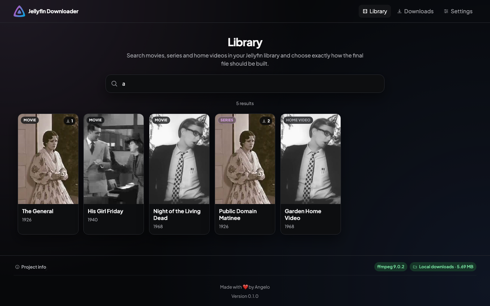
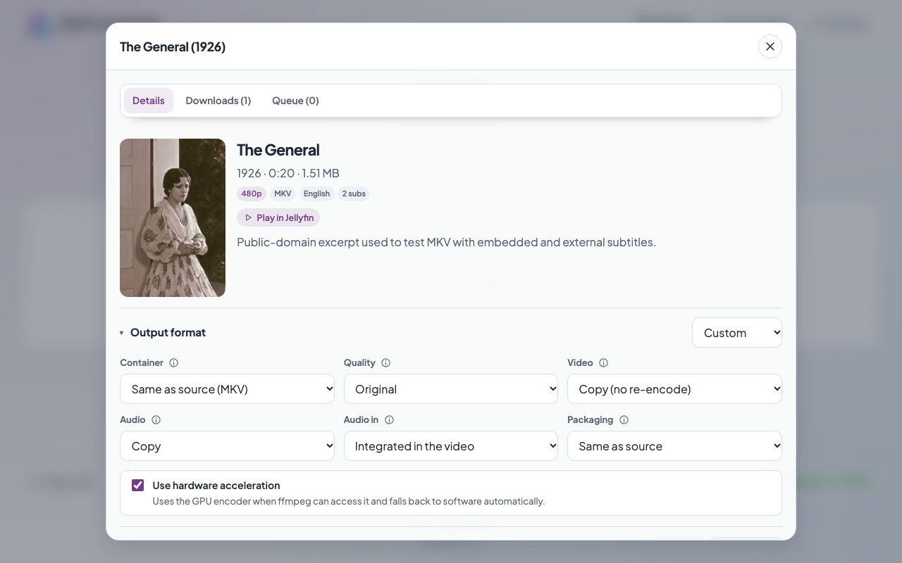

# Jellyfin Downloader

<p align="center">
  
</p>

<p align="center">
  <strong>Browse your Jellyfin library and build exactly the file you want.</strong><br />
  Movies, series and home videos · ffmpeg processing · self-hosted
</p>

<p align="center">
  <a href="LICENSE"></a>
  
  
  
</p>

Jellyfin Downloader is a self-hosted web app that turns your Jellyfin library into
downloadable files with the exact container, quality, codecs, audio tracks and
subtitles you choose. It can download individual items, selected episodes or a
whole series with one configuration.

The interface is available in **English, Spanish and Catalan**, with **system,
light and dark** themes.

## Contents

- [Screenshots](#screenshots)
- [What it does](#what-it-does)
- [Docker installation (recommended)](#docker-installation-recommended)
  - [1. Create a Jellyfin API key](#1-create-a-jellyfin-api-key)
  - [2. Configure the environment](#2-configure-the-environment)
  - [3. Start the container](#3-start-the-container)
  - [Connect the container to Jellyfin](#connect-the-container-to-jellyfin)
  - [Data and updates](#data-and-updates)
  - [Hardware acceleration in Docker](#hardware-acceleration-in-docker)
  - [Docker troubleshooting](#docker-troubleshooting)
- [Local installation (without Docker)](#local-installation-without-docker)
- [Using the app](#using-the-app)
  - [Series downloads](#series-downloads)
  - [Downloads and reproducibility](#downloads-and-reproducibility)
- [Configuration](#configuration)
- [API](#api)
- [Security](#security)
- [Persistence](#persistence)
- [Development](#development)
- [License](#license)

## Screenshots

<p align="center">
  
  
</p>
<p align="center">
  
  
</p>
<p align="center">
  
</p>

## What it does

- **Search movies, series and home videos** using Jellyfin's native search, with
  deep-linkable results, poster cards and infinite scroll with pagination.
- **Inspect real media sources**: video resolution, container, size, audio
  languages, subtitle tracks and multiple versions.
- **Open the item in Jellyfin** from the media dialog with the play button.
- **Build the output you want**: MKV, MP4 or WebM; original, 4K, 2K, 1080p,
  720p, 480p or 360p; copy or re-encode video/audio.
- **Choose subtitle packaging**: integrated, separate files or burn-in when
  supported by ffmpeg, with select-all controls for audio and subtitles.
- **Download one file or a ZIP** with video, audio and subtitle files split
  independently.
- **Use hardware encoding** automatically when VideoToolbox, NVENC, QSV or VAAPI
  is available, with a software fallback.
- **Download series in batches**: seasons collapsed by default, unavailable
  virtual episodes excluded, and one configuration for the selection.
- **Watch the queue**: active downloads appear on the cards and in a queue tab
  filtered to the open title or series, and can be paused, resumed, restarted or
  cancelled from the dialog or the downloads page. Clicking a queue title opens
  that item. Paused jobs keep their progress and survive a server restart.
- **Reuse local results** with deterministic cache keys and replicate a previous
  configuration from its badge.
- **See processing time** and original source size for every finished download.
- **Deep links for episodes** (`?modal=<episodeId>`) with a back button to the
  series and selectable seasons.
- **Keep notes and logs**: global notifications plus persisted JSONL logs in
  **Settings → Logs**.
- **Durable jobs**: queued and running jobs survive restarts and continue
  automatically.

## Docker installation (recommended)

Docker is the simplest way to run the app: the image already includes Node.js,
ffmpeg and the fonts needed for burned-in subtitles.

Requirements:

- Docker Engine 24+ or Docker Desktop;
- a Jellyfin server reachable from the container;
- a Jellyfin API key (step 1).

### 1. Create a Jellyfin API key

1. Open the Jellyfin dashboard and go to **API Keys**.
2. Select **+** and name it `jellyfin-downloader`.
3. Copy the generated key.

The key stays on the server; the browser never receives it.

### 2. Configure the environment

```bash
git clone https://github.com/angelespejo/jellyfin-downloader.git
cd jellyfin-downloader
cp .env.example .env
```

Edit `.env` with at least:

```dotenv
JELLYFIN_URL=http://host.docker.internal:8096
JELLYFIN_API_KEY=your_api_key
ORIGIN=http://localhost:3000
TZ=Europe/Madrid
```

- `JELLYFIN_URL` is the address **as seen from the container**, without a
  trailing slash. `localhost` there means the container itself; see
  [Connect the container to Jellyfin](#connect-the-container-to-jellyfin).
- `JELLYFIN_SERVER` is accepted as a deprecated alias of `JELLYFIN_URL`.
- `ORIGIN` must match the URL you open in the browser.
- `TZ` only affects dates in logs.

### 3. Start the container

```bash
mkdir -p data
docker compose up -d
```

Compose pulls `ghcr.io/angelespejo/jellyfin-downloader:latest`, a public image
for `linux/amd64` and `linux/arm64`; no registry login is needed. Open
<http://localhost:3000>.

```bash
docker compose ps
curl -s http://localhost:3000/api/v1/health
docker compose logs -f jellyfin-downloader
```

Useful options in `.env`:

| Variable                   | Default  | Purpose                           |
| -------------------------- | -------- | --------------------------------- |
| `JELLYFIN_DOWNLOADER_TAG`  | `latest` | Pin `0.2`, `0.2.0` or `latest`    |
| `JELLYFIN_DOWNLOADER_PORT` | `3000`   | Host port                         |
| `SERVER_DATA_DIR`          | `./data` | Host directory mounted at `/data` |

Without cloning the repository, write the same variables to `.env` and start the
container directly:

```bash
mkdir -p data
docker run -d --name jellyfin-downloader \
  --restart unless-stopped --init --stop-timeout 30 \
  -p 3000:3000 -v "$PWD/data:/data" --env-file .env \
  ghcr.io/angelespejo/jellyfin-downloader:latest
```

More recipes, from a minimal container to Jellyfin plus GPU passthrough, are in
[docs/docker-compose.md](docs/docker-compose.md).

### Connect the container to Jellyfin

`JELLYFIN_URL` is resolved inside the container, so it depends on where
Jellyfin runs:

| Where Jellyfin runs             | `JELLYFIN_URL`                     |
| ------------------------------- | ---------------------------------- |
| Docker Desktop host             | `http://host.docker.internal:8096` |
| Linux host, with `extra_hosts`  | `http://host.docker.internal:8096` |
| Linux host, without extra hosts | `http://<LAN-IP>:8096`             |
| Another compose service         | `http://jellyfin:8096`             |
| Another machine                 | `http://<hostname-or-IP>:8096`     |

The bundled `docker-compose.yml` has the `extra_hosts` block ready to uncomment
on Linux. If the value is wrong, search and downloads fail while the rest of the
interface keeps working.

### Data and updates

Everything persistent lives in `./data`, mounted at `/data`:

| Path            | Contents                    |
| --------------- | --------------------------- |
| `settings.json` | Global defaults and presets |
| `jobs/`         | Durable download jobs       |
| `downloads/`    | Reusable local output store |
| `logs/`         | Persisted JSONL logs        |

The container runs as `node` (UID 1000). On Linux, a custom directory must be
writable by that user: `sudo chown -R 1000:1000 ./data`.

Update to the newest release with:

```bash
docker compose pull
docker compose up -d
```

`stop_grace_period: 30s` lets the app persist job state on shutdown, so queued and
running downloads resume after an update or restart. `docker compose down` keeps
the bind-mounted data.

At startup the server prints a banner with the URL, Jellyfin host, data directory
and storage mode, then logs ffmpeg, hardware and Jellyfin connectivity events in
`logs/`.

### Hardware acceleration in Docker

The app probes the container at startup and falls back to software when a
hardware encoder fails. VAAPI/QSV on Linux needs the render device:

```yaml
devices:
  - /dev/dri:/dev/dri
group_add:
  - video
  - render
```

Set `FFMPEG_HWACCEL=vaapi` or `qsv` to force it, or keep `auto`. NVENC requires
the NVIDIA container toolkit and the host driver. VideoToolbox is only available
when running natively on macOS; it does not exist in the Linux container.

### Docker troubleshooting

| Symptom                           | Fix                                                                 |
| --------------------------------- | ------------------------------------------------------------------- |
| Cannot reach Jellyfin             | Check `JELLYFIN_URL`: use the host gateway, LAN IP or service name  |
| `permission denied` under `/data` | `sudo chown -R 1000:1000 ./data` (Linux)                            |
| `port is already allocated`       | Set `JELLYFIN_DOWNLOADER_PORT` to a free port                       |
| Container reports `unhealthy`     | `docker compose logs jellyfin-downloader`; verify port and `ORIGIN` |
| Job fails immediately             | Check `http://localhost:3000/api/v1/health` and the job logs        |

See [docs/docker.md](docs/docker.md) for the image details and
[docs/configuration.md](docs/configuration.md) for every variable.

## Local installation (without Docker)

Docker is recommended for production. To run from source, you need **Node.js
22.17+** (24 recommended), **pnpm 12** and **ffmpeg**.

```bash
cp .env.example .env
# Edit .env with JELLYFIN_URL and JELLYFIN_API_KEY
pnpm install
pnpm dev-remote
```

Open <http://localhost:5173>.

To try the app without a Jellyfin server:

```bash
pnpm dev
```

This downloads a few public-domain clips, starts the development Jellyfin mock and
launches the app.

## Using the app

1. Search for a movie, series or home video.
2. Open a result. For a series, choose an episode or use **Download episodes**.
3. Pick a preset or configure the output manually.
4. Select audio and subtitle packaging.
5. Download and wait for the job to finish.
6. Find finished files in **Downloads**.

Output names follow `Title (year) - Preset.ext`, or `Title (year) - custom.ext`
when no preset is used. Episodes include the series and `S01E02` code.

### Series downloads

Use **Download episodes**, select individual episodes or whole seasons, and
configure the output once. The app creates one durable job per selected episode.

### Downloads and reproducibility

When the local store is enabled (default), results are reused by a deterministic
key. Each download shows its preset/configuration badge; open it to see every
option or replicate the configuration in the media dialog. Set
`SERVER_LOCAL_DOWNLOADS_ENABLED=false` to disable the store.

## Configuration

The most important variables are:

| Variable                         | Default            | Purpose                                                 |
| -------------------------------- | ------------------ | ------------------------------------------------------- |
| `JELLYFIN_URL`                   | —                  | Jellyfin base URL                                       |
| `JELLYFIN_PUBLIC_URL`            | `JELLYFIN_URL`     | Browser-facing Jellyfin URL for the Play button         |
| `JELLYFIN_API_KEY`               | —                  | Server-side Jellyfin API key                            |
| `FFMPEG_PATH`                    | auto               | ffmpeg binary or directory                              |
| `FFMPEG_HWACCEL`                 | `auto`             | `auto`, `none`, `videotoolbox`, `nvenc`, `qsv`, `vaapi` |
| `SERVER_LOCAL_DOWNLOADS_ENABLED` | `true`             | Reuse and keep finished downloads                       |
| `SERVER_JOBS_DIR`                | `./data/jobs`      | Durable job state                                       |
| `SERVER_LOCAL_DOWNLOADS_DIR`     | `./data/downloads` | Local output store                                      |
| `SERVER_LOGS_DIR`                | `./data/logs`      | Persisted logs                                          |
| `ORIGIN`                         | —                  | Public URL behind a reverse proxy                       |
| `API_CORS_ORIGINS`               | empty              | Optional CORS allowlist                                 |

`JELLYFIN_SERVER` still works as a deprecated alias of `JELLYFIN_URL`.

The bundled `docker-compose.yml` also reads `JELLYFIN_DOWNLOADER_TAG`,
`JELLYFIN_DOWNLOADER_PORT` and `SERVER_DATA_DIR` from `.env`.

See [docs/configuration.md](docs/configuration.md) for every variable and
[docs/docker.md](docs/docker.md) for hardware passthrough.

## API

The web UI uses the same public API:

- Interactive docs: `http://localhost:3000/api/v1/docs`
- OpenAPI 3.1: `http://localhost:3000/api/v1/openapi.json`
- API guide: [docs/api.md](docs/api.md)

```bash
curl -s 'http://localhost:3000/api/v1/movies?q=general'
```

## Security

- The Jellyfin API key never reaches the browser.
- The **Play in Jellyfin** button redirects through `/watch/{id}`; set
  `JELLYFIN_PUBLIC_URL` when the browser must use a different Jellyfin address.
- ffmpeg runs with discrete arguments and `shell: false`.
- Client input is validated against real Jellyfin metadata.
- The app has **no built-in authentication**. Run it behind a reverse proxy or
  VPN. See [docs/security.md](docs/security.md).

## Persistence

Jobs are atomic JSON files under `SERVER_JOBS_DIR`. After a restart, queued and
running jobs are re-queued, complete source files are reused, partial ffmpeg
outputs are discarded and the job continues. See [docs/jobs.md](docs/jobs.md).

## Development

TypeScript-only SvelteKit project. SvelteKit's `build/` output is generated.

```bash
pnpm install
pnpm check
pnpm test
pnpm lint
pnpm format:check
pnpm build
pnpm security:audit
```

- [Development documentation](docs/development.md)
- [Architecture](docs/architecture.md)
- [Testing](docs/testing.md)
- [Troubleshooting](docs/troubleshooting.md)

## License

[MIT](LICENSE) © Angelo

If you find this project useful, you can support its development on
[GitHub Sponsors](https://github.com/sponsors/angelespejo).
