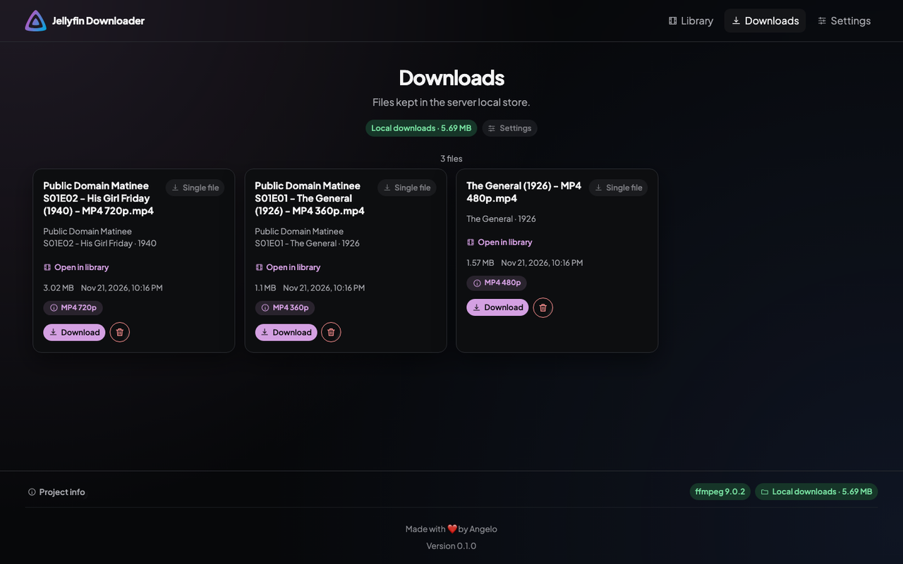
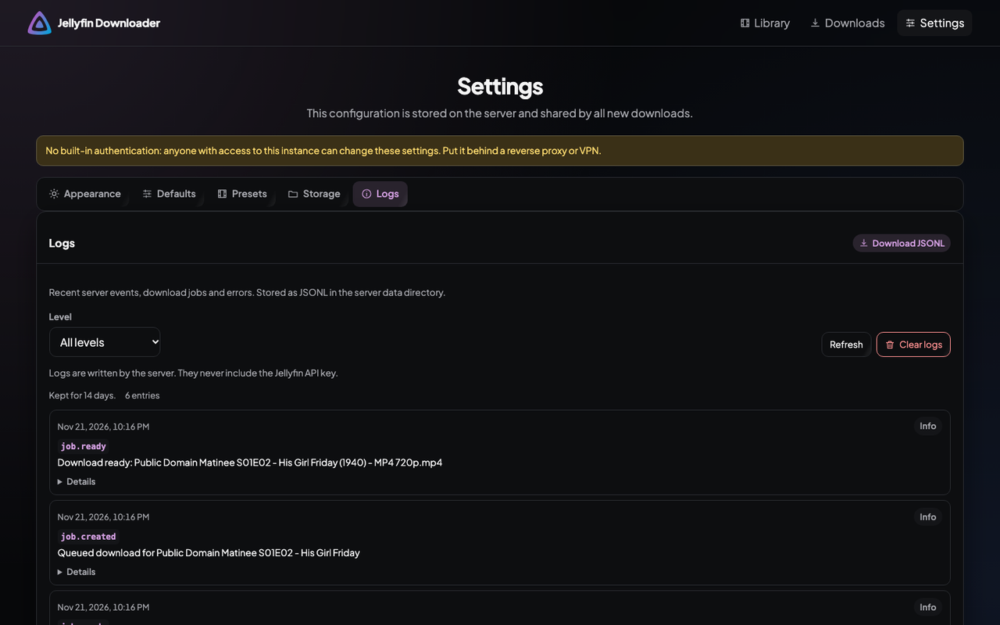

# Jellyfin Downloader

<p align="center">
  
</p>

<p align="center">
  <strong>Browse your Jellyfin library and build exactly the file you want.</strong><br />
  Movies, series and home videos · ffmpeg processing · self-hosted
</p>

<p align="center">
  <a href="LICENSE"></a>
  
  
  
</p>

Jellyfin Downloader is a self-hosted web app that turns your Jellyfin library into
downloadable files with the exact container, quality, codecs, audio tracks and
subtitles you choose. It can download individual items, selected episodes or a
whole series with one configuration.

The interface is available in **English, Spanish and Catalan**, with **system,
light and dark** themes.

## Screenshots

<p align="center">
  
  
</p>
<p align="center">
  
  
</p>
<p align="center">
  
</p>

## What it does

- **Search movies, series and home videos** from Jellyfin, with deep-linkable
  results and poster cards.
- **Inspect real media sources**: video resolution, container, audio languages,
  subtitle tracks and multiple versions.
- **Build the output you want**: MKV, MP4 or WebM; original, 4K, 2K, 1080p,
  720p, 480p or 360p; copy or re-encode video/audio.
- **Choose subtitle packaging**: integrated, separate files or burn-in when
  supported by ffmpeg.
- **Download one file or a ZIP** with video, audio and subtitle files split
  independently.
- **Use hardware encoding** automatically when VideoToolbox, NVENC, QSV or VAAPI
  is available, with a software fallback.
- **Download series in batches**: select episodes or whole seasons and apply one
  configuration.
- **Reuse local results** with deterministic cache keys and replicate a previous
  configuration from its badge.
- **Keep notes and logs**: global notifications plus persisted JSONL logs in
  **Settings → Logs**.
- **Durable jobs**: queued and running jobs survive restarts and continue
  automatically.

## Quick start with Docker

Requirements: Docker and Docker Compose.

```bash
cp .env.example .env
# Edit .env with JELLYFIN_SERVER and JELLYFIN_API_KEY
mkdir -p data
docker compose up -d --build
```

Open <http://localhost:3000>.

| Path in `data/` | Contents                    |
| --------------- | --------------------------- |
| `settings.json` | Global defaults and presets |
| `jobs/`         | Durable download jobs       |
| `downloads/`    | Optional local output store |
| `logs/`         | Persisted JSONL logs        |

If Jellyfin runs on the Docker host, use `host.docker.internal` (on Linux,
uncomment `extra_hosts` in `docker-compose.yml`). Behind a reverse proxy, set
`ORIGIN` to the public URL.

## Quick start without Docker

Requirements: **Node.js 22.17+** (24 recommended), **pnpm 12** and **ffmpeg**.

```bash
cp .env.example .env
# Edit .env with JELLYFIN_SERVER and JELLYFIN_API_KEY
pnpm install
pnpm dev-remote
```

Open <http://localhost:5173>.

To try the app without a Jellyfin server:

```bash
pnpm dev
```

This downloads a few public-domain clips, starts the development Jellyfin mock and
launches the app.

## Using the app

1. Search for a movie, series or home video.
2. Open a result. For a series, choose an episode or use **Download episodes**.
3. Pick a preset or configure the output manually.
4. Select audio and subtitle packaging.
5. Download and wait for the job to finish.
6. Find finished files in **Downloads**.

Output names follow `Title (year) - Preset.ext`, or `Title (year) - custom.ext`
when no preset is used. Episodes include the series and `S01E02` code.

### Series downloads

Use **Download episodes**, select individual episodes or whole seasons, and
configure the output once. The app creates one durable job per selected episode.

### Downloads and reproducibility

When the local store is enabled, results are reused by a deterministic key. Each
download shows its preset/configuration badge; open it to see every option or
replicate the configuration in the media dialog.

## Configuration

The most important variables are:

| Variable                         | Default            | Purpose                                                 |
| -------------------------------- | ------------------ | ------------------------------------------------------- |
| `JELLYFIN_SERVER`                | —                  | Jellyfin base URL                                       |
| `JELLYFIN_API_KEY`               | —                  | Server-side Jellyfin API key                            |
| `FFMPEG_PATH`                    | auto               | ffmpeg binary or directory                              |
| `FFMPEG_HWACCEL`                 | `auto`             | `auto`, `none`, `videotoolbox`, `nvenc`, `qsv`, `vaapi` |
| `SERVER_LOCAL_DOWNLOADS_ENABLED` | `false`            | Enable reusable local outputs                           |
| `SERVER_JOBS_DIR`                | `./data/jobs`      | Durable job state                                       |
| `SERVER_LOCAL_DOWNLOADS_DIR`     | `./data/downloads` | Local output store                                      |
| `SERVER_LOGS_DIR`                | `./data/logs`      | Persisted logs                                          |
| `API_CORS_ORIGINS`               | empty              | Optional CORS allowlist                                 |

See [docs/configuration.md](docs/configuration.md) for every variable and
[docs/docker.md](docs/docker.md) for hardware passthrough.

## API

The web UI uses the same public API:

- Interactive docs: `http://localhost:3000/api/v1/docs`
- OpenAPI 3.1: `http://localhost:3000/api/v1/openapi.json`
- API guide: [docs/api.md](docs/api.md)

```bash
curl -s 'http://localhost:3000/api/v1/movies?q=general'
```

## Security

- The Jellyfin API key never reaches the browser.
- ffmpeg runs with discrete arguments and `shell: false`.
- Client input is validated against real Jellyfin metadata.
- The app has **no built-in authentication**. Run it behind a reverse proxy or
  VPN. See [docs/security.md](docs/security.md).

## Persistence

Jobs are atomic JSON files under `SERVER_JOBS_DIR`. After a restart, queued and
running jobs are re-queued, complete source files are reused, partial ffmpeg
outputs are discarded and the job continues. See [docs/jobs.md](docs/jobs.md).

## Development

TypeScript-only SvelteKit project. SvelteKit's `build/` output is generated.

```bash
pnpm install
pnpm check
pnpm test
pnpm lint
pnpm format:check
pnpm build
pnpm security:audit
```

- [Development documentation](docs/development.md)
- [Architecture](docs/architecture.md)
- [Testing](docs/testing.md)
- [Troubleshooting](docs/troubleshooting.md)

## License

[MIT](LICENSE) © Angelo

If you find this project useful, you can support its development on
[GitHub Sponsors](https://github.com/sponsors/angelespejo).
